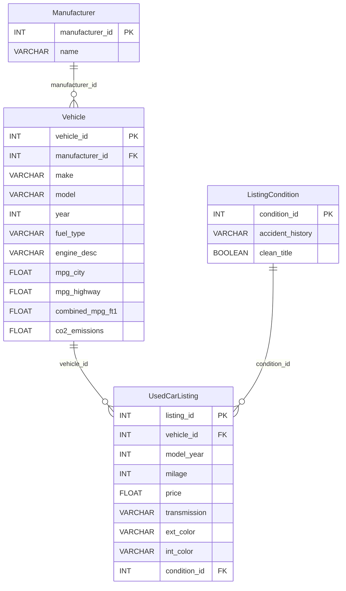

# Used Car Market SQL Analysis

[](https://github.com/chahatpatel2003/used-car-market-sql/actions/workflows/tests.yml)

A normalized MySQL database that links EPA fuel-economy data with used-car listings, plus 15 analytical queries on price, mileage, fuel type, emissions and listing condition. This was a course project for CSCI 126 at California State University, Fresno, Summer 2025.

## Technical highlights

| Area | What it shows | From |
|---|---|---|
| Relational design | Four-table schema in third normal form, with primary and foreign keys linking EPA vehicle specifications to resale listings | 2025 project |
| Analytical SQL | 15 queries using joins across up to four tables, scalar subqueries, `CASE` bucketing, aggregation and computed ratios | 2025 project |
| SQL review | Defects in queries 3, 5, 6 and 9 found and corrected, plus a portability fix to query 7; each is demonstrated by a test | Added 2026 |
| Testing without a server | sqlglot translates the MySQL to DuckDB; 42 pytest tests on synthetic edge-case data; CI on Python 3.11–3.13 with a lint check | Added 2026 |

**Stack:** MySQL, SQL, DuckDB, sqlglot, Python, pytest, Ruff, GitHub Actions.

## What is original and what is not

The project files were recovered from Google Drive in October 2026. The SQL survived in the project documents, but the dataset and loading scripts did not.

| File | Status |
|---|---|
| `sql/schema.sql` | **Recovered original.** The four `CREATE TABLE` statements, verbatim from the project report. |
| `sql/queries.sql` | **Recovered original.** The 15 queries, verbatim. Only the `-- Query N: title` heading comments were added. |
| `results/recovered_original_outputs/` | **Recovered original results.** Outputs of queries 3, 5, 9, 11 and 15 from the original 300-listing dataset, as saved in the project documents. |
| `docs/er_diagram_original.jpg` | **Recovered original** ER diagram. |
| `sql/queries_corrected.sql` | Corrections made in October 2026 (AI-assisted) to the defects listed below. |
| `run_queries.py`, `tests/`, `sample_data/` | Added in October 2026 (AI-assisted) to make the SQL runnable and testable. The sample data is **synthetic**. |

**Not recovered:**
- the cleaned 300-listing dataset;
- the data-cleaning and loading scripts;
- the outputs of the other 10 queries.

The original results therefore can't be re-run. See [PROVENANCE.md](PROVENANCE.md).

## Data sources

The project combined two public Kaggle datasets, which aren't redistributed here:
- [Fuel Economy](https://www.kaggle.com/datasets/sahirmaharajj/fuel-economy): EPA specifications such as make, model, year, fuel type, engine, city and highway MPG, and CO₂ emissions.
- [Used Car Price Prediction](https://www.kaggle.com/datasets/taeefnajib/used-car-price-prediction-dataset): listings with model year, mileage, price, transmission, colours, accident history and title status.

## Schema



The design is normalized to third normal form:
- Manufacturers are stored once and referenced by `manufacturer_id`, instead of repeating the brand name on every vehicle.
- Each listing references one vehicle, which links resale data to EPA specifications.
- Accident-history and title-status combinations repeat across many listings, so they are stored once in `ListingCondition`.
- The column name `milage` keeps the spelling of the Kaggle source column.

The diagram above is generated from `schema.sql`. The original diagram (`docs/er_diagram_original.jpg`) differs from the schema in two ways:
- It links `ListingCondition` to `Vehicle`, but the schema links it to `UsedCarListing`.
- It omits the foreign-key columns.

## The 15 queries

| # | Question | SQL used |
|---:|---|---|
| 1 | Average used price by fuel type | `JOIN`, `AVG`, `GROUP BY` |
| 2 | Average price by brand and model year | 3-table join, two-column grouping |
| 3 | Vehicles with above-average fuel economy | scalar subquery, `DISTINCT` |
| 4 | Most common transmission per fuel type | `COUNT`, multi-column ordering |
| 5 | Lowest price per mile driven | computed column, `NULLIF` |
| 6 | Highest tailpipe CO₂ emissions | `ORDER BY … LIMIT` |
| 7 | Most expensive listings with an accident history | 4-table join, `LIKE` |
| 8 | Average price by transmission | `GROUP BY` |
| 9 | Average price by mileage bracket | `CASE` bucketing |
| 10 | Number of listings per brand | `COUNT` |
| 11 | Cheapest listings under 60,000 miles | filter and sort |
| 12 | Average price by exterior colour | `NULL` filtering |
| 13 | Listings by interior colour | `COUNT` |
| 14 | Oldest listings by model year | sort |
| 15 | Listings with and without a clean title | join, `GROUP BY` a boolean column |

## Results on the original dataset (recovered)

Only five query outputs survived. All five are in `results/recovered_original_outputs/`.

**Query 9: price falls at every mileage bracket.**

| Mileage | Average price |
|---|---:|
| Under 30k | $76,824 |
| 30k–60k | $38,197 |
| 60k–100k | $23,463 |
| Over 100k | $14,159 |

**Query 15:** all 300 listings in the sample had a clean title. The clean-versus-salvage comparison the project planned therefore wasn't possible with this sample.

**Query 3:** the most fuel-efficient vehicles were led by a 2017 Chevrolet Malibu Hybrid (46 mpg combined) and a 1989 Geo Metro LSI (41 mpg).

**Caveats visible in the recovered outputs:**
- **Query 5's price-per-mile ranking:** it favours very high-mileage cars. All 15 rows have more than 130,000 miles, so it measures how cheap a car is per mile already driven, not how good a deal it is.
- **Implausible rows:** some rows look wrong, for example a 2008 BMW M4 (the M4 was introduced in 2014) and a Porsche 911 Turbo S with 19,700 miles listed at $13,500. This suggests the lost loading step misaligned some fields. Without the scripts and data, it can't be traced.

## Defects found and corrected

`sql/queries.sql` keeps the originals unchanged; `sql/queries_corrected.sql` contains the fixes. Each defect and fix is demonstrated by a test on synthetic edge-case data.

| Query | Problem in the original | Correction |
|---|---|---|
| 3, 6 | Joined `Manufacturer` on `v.make = m.name` instead of the foreign key. Any vehicle whose make text differs from the manufacturer's name (e.g. "Ford Motor" vs "Ford") silently disappears. | Join on `manufacturer_id` |
| 5 | A zero-mileage listing gets a `NULL` price per mile, and MySQL sorts `NULL` first, so it would rank as the "best" deal. This didn't occur in the original data, whose top row is $0.01 per mile. Sorting on the rounded ratio also leaves ties unordered. | Exclude zero mileage; sort on the unrounded ratio |
| 9 | A listing with unknown mileage falls through to `ELSE` and is counted as "Over 100k". | Add an "Unknown" bracket |
| 7 | `LIKE '%accident%'` relies on MySQL's case-insensitive collation. | Compare `LOWER(...)`, for portability |

**Noted, not changed:**
- `price` is a single-precision `FLOAT`; `DECIMAL(10,2)` is the usual type for money.
- The report says the analysis used a view, but no view appears in the recovered SQL.

## Run it

```bash
python3 -m pip install -r requirements.txt
python run_queries.py                  # original queries on the synthetic sample
python run_queries.py --corrected      # corrected queries
python run_queries.py --query 9 --data my_inserts.sql   # your own INSERT statements
python -m pytest                       # 42 tests
```

The SQL is MySQL. `run_queries.py` uses [sqlglot](https://github.com/tobymao/sqlglot) to translate each statement to DuckDB, so no database server is needed. The queries were tested this way, not on a MySQL server.

`requirements.txt` gives minimum versions. `requirements-lock.txt` pins the exact versions the tests were last run with locally (Python 3.12). The tests have also passed locally on Python 3.13, and GitHub Actions runs them on Python 3.11, 3.12 and 3.13 on every push.

## Repository structure

```text
.
├── sql/
│   ├── schema.sql                recovered original (MySQL)
│   ├── queries.sql               recovered original, 15 queries
│   └── queries_corrected.sql     corrected queries
├── results/recovered_original_outputs/   original outputs of queries 3, 5, 9, 11, 15
├── sample_data/synthetic_edge_cases.sql  synthetic rows for the demo and tests
├── docs/er_diagram_original.jpg
├── run_queries.py
├── tests/test_queries.py
├── .github/workflows/tests.yml   CI: pytest on Python 3.11–3.13, plus Ruff
├── requirements.txt              minimum versions
├── requirements-lock.txt         exact versions last tested
└── PROVENANCE.md
```
